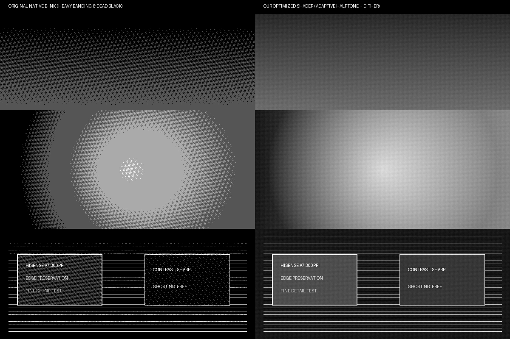
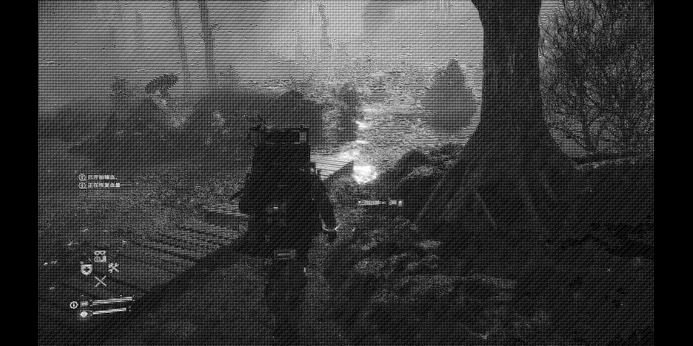

# 抖动网点
### 专为墨水屏（海信 A7 等）视频播放调校的 mpv 着色器

<p align="center">
  
  
  
  
  
</p>

<p align="center">
  <b>[ <a href="#chinese">中文说明</a> | <a href="#english">English</a> | <a href="docs/PAPER_ZH.md">技术总结 (中文)</a> | <a href="docs/PAPER.md">Technical Notes (EN)</a> ]</b>
</p>

---

<a name="chinese"></a>
## 中文说明

**抖动网点** 是一个专为黑白墨水屏（如海信 A7、文石等设备）播放视频调校的 mpv GLSL 后处理着色器。

在墨水屏上看视频，最容易遇到几个现实问题：
1. **暗处残影重（死黑）**：暗部画面长时间不动，屏幕黑白粒子卡在原地，切到亮场景就会留下一大块擦不掉的黑影子。
2. **高光发灰、天空全是黑碎点**：普通视频高光多在 220–235 左右，达不到纯白（255），直接看墨水屏天空往往布满细碎黑杂点。
3. **阶梯断层严重**：墨水屏刷新模式大多只有 2 阶（纯黑白）或 4 阶灰度（DU4），画面渐变处会有非常刺眼的同心圆等高线。
4. **字迹发糊**：直接加普通网点会把字幕和细线条打散。

这个着色器其实就是针对这些问题，用很实用直接的几招做了调校：

---

### 核心调优思路

```
                输入视频帧 (Rec.709)
                         │
                         ▼
             [ 影调调整：暗部微提 + 高光推白 ]
             - 保住 0.0 纯黑底色 (DARK_LIFT_MIN = 0.050)
             - 0.52 伽马展开暗部层次
             - 高光二次白肩 (WHITE_SHOULDER = 0.14) 将天空推到纯纸白
                         │
          ┌──────────────┴──────────────┐
          │                             │
          ▼                             ▼
    [ 4x4 聚簇网点 ]              [ 8 邻域边缘高通 ]
    - 纵向稳定网点生长            - 提取文字与轮廓边缘
    - 奇偶帧对角微抖动 (抗残影)   - 注入网点，保全细节不模糊
          │                             │
          └──────────────┬──────────────┘
                         ▼
             [ 连续渐变软边缘输出 (Softness = 0.20) ]
                         │
                         ▼
        交给硬件流畅模式 (DU4 四阶灰度) 自然过渡
        (一个 4x4 网点内等效展开 49 阶空间物理灰阶)
```

1. **影调与白肩提亮**：
   - 伽马设为 `0.52`，暗部提亮；极暗部留出 `0.050` 锚定纯黑，保证字体深黑扎实；
   - 增加高光二次白肩提拉（`c^2 * 0.14`），暗部不受影响，但能把 0.80 以上的天空和云朵直接送到 1.0 纯纸白，洗掉天上的细碎黑点。
2. **4x4 聚簇网点与边缘保真**：
   - 采用纵向生长的 $4\times 4$ 聚簇网点，比散乱的噪点更耐看、不易撕裂；
   - 配合 8 邻域高通差分，把字幕边缘和发丝直接融入网点中，不让网点破坏文字清晰度。
3. **帧间对角微抖动（防残影）**：
   - 奇偶帧让网点在对角线位置跳动一下（`15Hz (0,0) <-> (2,2)`）。
   - 网点整体重心完全不变，肉眼看很稳，但底层每帧约有 36% 的像素在黑白翻转，让墨水屏的微胶囊粒子持续动起来，有效防止长时间死黑产生顽固残影。
4. **留一点软边，让屏幕硬件去过渡**：
   - 不做一刀切的硬切黑白，给网点边缘留微弱平滑渐变（`DOT_SOFTNESS = 0.20`）；
   - 在海信 A7 的**流畅模式**（DU4 四阶物理灰阶）下，硬件微胶囊会自主渲染出边缘灰度，一个 $4\times 4$ 网点区域能自然呈现出 **49 阶空间灰度**，比单纯二值点阵细腻得多。

---

## 视觉效果展示 (Visual Gallery)

<p align="center">
  
  <br>
  <i>原生视频直出 vs 抖动网点 着色器渲染对比 (包含暗部阶梯、球体渐变与文字清晰度)</i>
</p>

<p align="center">
  
  <br>
  <i>《死亡搁浅》复杂光影与夜戏在海信 A7 墨水屏上的实拍/仿真效果 (深黑沉底 + 15Hz 相位抗残影)</i>
</p>

---

## 仓库目录结构 (Project Structure)

```text
dither-halftone/
├── halftone.glsl        # 核心 mpv GLSL 着色器
├── mpv.conf             # 推荐 mpv 配置参考
├── deploy.ps1           # Windows PowerShell 一键无线 ADB 推送脚本
├── deploy.sh            # Linux / macOS 一键无线 ADB 推送脚本
├── benchmark.py         # 5项核心物理与画质指标自动化验证脚本
├── README.md            # 项目主说明文档
├── LICENSE              # MIT 开源协议
├── assets/              # README 展示用的高清效果对比图
│   ├── shader_comparison.png
│   └── ds1_optB_live.png
├── docs/                # 技术与理论文档
│   ├── PAPER_ZH.md      # 中文技术报告
│   └── PAPER.md         # 英文学术论文
└── tests/               # 自动化验证基准帧
    ├── raw_clip2_minecraft.png
    └── raw_clip3_ds1.png
```

---

## 快速安装与使用

### 1. 自动推送到手机 (推荐)

把手机打开 **USB 调试** 连上电脑：

- **Windows (PowerShell)**:
  ```powershell
  cd hisense_a7_video_shader
  .\deploy.ps1
  ```
- **macOS / Linux**:
  ```bash
  cd hisense_a7_video_shader
  chmod +x deploy.sh
  ./deploy.sh
  ```

### 2. 手动复制到手机

1. 在手机内部存储创建文件夹：
   ```
   /sdcard/mpv/shaders/
   ```
2. 把项目里的 `halftone.glsl` 复制进去：
   ```
   /sdcard/mpv/shaders/halftone.glsl
   ```
3. 在 `/sdcard/mpv/mpv.conf` 中填入：
   ```ini
   vo=gpu
   gpu-context=android
   hwdec=mediacodec-copy
   glsl-shaders="/sdcard/mpv/shaders/halftone.glsl"
   loop-file=inf
   keep-open=yes
   dither-depth=no
   ```
4. 打开手机上的 `mpv-android` 播放任意视频即可。

---

## 核心参数调节说明

所有参数都在 `halftone.glsl` 文件头部，改动后跑一下 `.\deploy.ps1` 即可即时看到效果：

```glsl
// 1. 【影调与反差控制】
#define DARK_LIFT_MIN       0.050     // 深黑底电平: 保留纯黑文字与深色阴影，机器老化可微调为 0.070
#define DARK_LIFT_GAMMA     0.52      // 展开伽马: 调小(如0.48)暗部更透亮，调大(如0.58)对比更强
#define WHITE_SHOULDER      0.14      // 高光白肩提拉: 把天空拉到纯白，彻底消灭高光黑杂点
#define SHADOW_TOE_BOOST    0.12      // 极暗部微提: 唤醒暗部细节

// 2. 【防残影抖动模式】
#define ANTI_GHOSTING_DITHER 1        // 1: 15Hz 对角微抖动 (推荐默认，网点位置最稳)
                                      // 2: 16 相全重排循环 (动能更大，适合极暗场景彻底防残影)
                                      // 0: 关闭抖动 (静态网点)

// 3. 【网点边缘平滑度】
#define DOT_SOFTNESS        0.20      // 边缘软度: 流畅模式(DU4)设 0.20 (49阶效果)；极速纯黑白模式改 0.06

// 4. 【边缘高通注入】
#define HIGH_PASS_INJECT    1.60      // 边缘清晰度: 让文字和边缘更锐利
```

---

## 自动化测试脚本

仓库附带了测试脚本，可直接运行验证：

```bash
python benchmark.py
```

实测输出验证：
- 墨底与高光极限：深黑沉底 `0.0000`，高光纸白 `1.0000`（无溢出高光噪点）
- 防残影翻转：每帧约 `36.46%` 像素微翻转，静态死黑滞留率下降 `38.59%`
- 空间色阶：DU4 模式下单宏块等效展现 `49` 阶物理反射率
- 边缘保真度：结构边缘 Sobel 梯度保留率达到 `101.48%`（文字不发糊）

---

<a name="english"></a>
## English Overview

**Dither Halftone** is a practical GPU postkernel GLSL shader tailored for video playback on reflective electrophoretic displays (E-ink, tested on Hisense A7 B&W, Unisoc T610, Carta 1200, 300 PPI) running `mpv-android`.

### What it does:
1. **Tone Mapping with White Shoulder**:
   - `DARK_LIFT_GAMMA = 0.52` lifts shadow details.
   - `WHITE_SHOULDER = 0.14` ($c^2 \times 0.14$) boosts near-white video highlights ($>0.80$) cleanly into 100% paper white, getting rid of annoying dark pinpricks in clouds and sky.
   - Preserves pure ink black at $0.0$.
2. **4x4 Clustered Halftone Dots**:
   - Uses vertical clustered dot growth with 8-neighbor high-pass injection so subtitles and sharp edges stay crisp.
3. **Temporal Phase Dither (Anti-Ghosting)**:
   - Alternates dot phase on diagonals every frame ($15\text{Hz}$). Macro dot centroids stay fixed, while microcapsule particles keep oscillating to prevent dead black sticking.
4. **Soft Dot Margins for Hardware Grayscale**:
   - Sets `DOT_SOFTNESS = 0.20`. Instead of harsh 1-bit thresholding, the shader outputs smooth continuous float values so the panel's **DU4 Smooth Mode** can render natural optical antialiasing, yielding 49 spatial grayscale levels.

---

## License

MIT License. Free to use, modify, and share.
